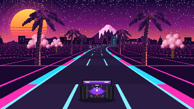
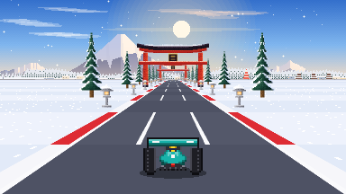
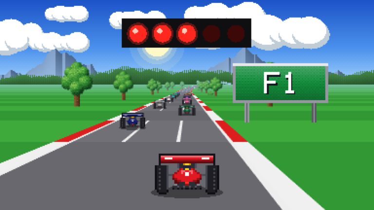
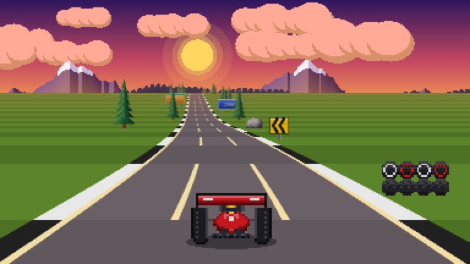
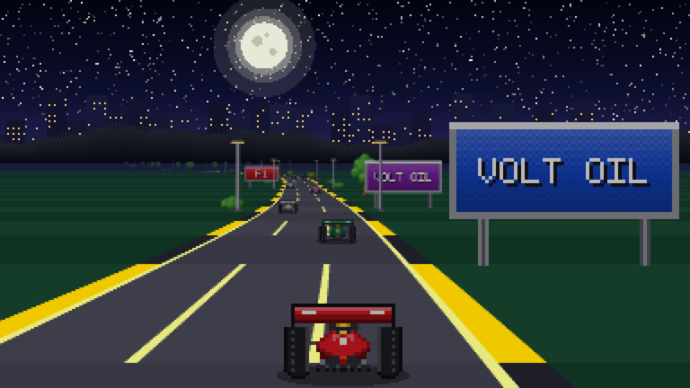

# pegasus-f1

A retro pseudo-3D Formula racer for the terminal, inspired by the F1
cartridges on the Pegasus / Famicom-clone consoles, with graphics a console
generation later: 16-bit style. Written in Rust with [ratatui](https://ratatui.rs).
Sound comes from a tiny chiptune-style synth (pulse-wave engine, beeps and noise)
via [cpal](https://github.com/RustAudio/cpal), plus an exclusive soundtrack
for each Japanese track.




## Play

```sh
cargo run --release
```

Every start plays a short "Crystal BIOS" self-test that types out your real
terminal setup before the menu. Press any key to skip it, or start with
`--no-intro`.

Options: `--mute`, `--no-intro`, `--truecolor` / `--256` (colour mode is auto-detected),
`--pixels` / `--quadrant` / `--halfblock` (graphics mode, see below).

## Graphics modes

Switch between modes at any time with `V` (or in the menu):

| Mode | Resolution | Works in |
| --- | --- | --- |
| **Pixels** | true ~16-bit console resolution (e.g. 384×216) | kitty, Ghostty, WezTerm (kitty graphics protocol, auto-detected) |
| **Quadrant** (default elsewhere) | 2×2 pixels per character cell | any terminal with a Unicode font |
| **Half blocks** | 1×2 pixels per character cell | any terminal |

In the text modes, the resolution depends on the terminal size, so a smaller
font (`Cmd -`) or a bigger window gives sharper graphics.

| Key | Action |
| --- | --- |
| `←` `→` / `A` `D` | Steer |
| `↑` / `W` | Accelerate |
| `↓` / `S` | Brake |
| `Space` / `G` | Shift gear LO ⇄ HI (manual gearbox) |
| `P` / `Esc` | Pause |
| `M` | Mute |
| `V` | Cycle graphics mode |
| `Q` | Quit (from menu / pause) |

Start from the back of a 12-car grid, wait for the five red lights to go
out, and fight your way to the front over 3 laps. Watch for crests: climbing
costs speed, and you can't see what's behind the top of a hill. Shift up to HI at around
100 km/h: LO gear tops out near 200 km/h. Bends throw you outward, so ease
off in the tight ones. Going off the road slows you down, and hitting a tree,
a sign or another car sends you spinning.

**Tip:** for the best controls, use a terminal that supports the kitty keyboard
protocol (kitty, WezTerm, Ghostty, foot, recent iTerm2/Alacritty). It reports
key releases, so you hold `↑` to accelerate. In other terminals (e.g. macOS
Terminal.app) the game switches to *auto-throttle*: the car accelerates on its
own and you hold `↓` to brake.

## Tracks

- **Neon Sakura**: synthwave sunset with a striped retro sun, a neon grid
  floor, palm-lined boulevards, katakana neon signs and a tunnel of torii
  gates, to a synthwave soundtrack.
- **Shirayuki Pass**: a sunny winter afternoon in the Japanese mountains.
  A snow-capped volcano, a pastel town with a bullet train gliding past,
  snow-laden cedars and white birches, vending machines, stone lanterns
  along a shrine approach under snowy torii, and glittering snow, to a
  breezy city-pop soundtrack.

Each track's soundtrack previews softly in the menu when it is selected.

### Classic tracks

Three original tracks are locked by default: **Danube Ring** (sunny
parkland), **Carpathian Circuit** (twisty mountain road at sunset) and
**Baltic Night GP** (night race under the lights). Unlock them under
*Settings → Classics* in the menu. The choice is saved to
`~/.config/pegasus-f1/settings` (or `$XDG_CONFIG_HOME/pegasus-f1/settings`).




