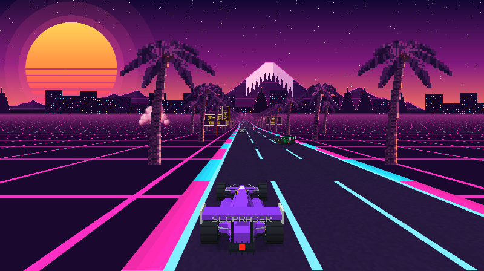
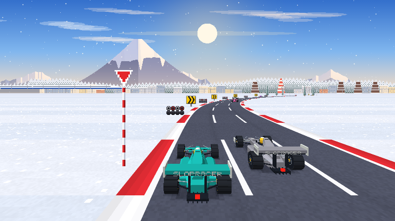
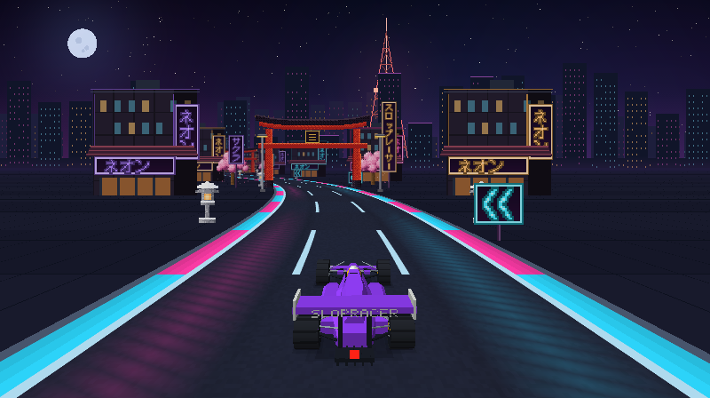

# Slopracer F1

**[Play Slopracer F1 in your browser](https://slopracer-f1.pages.dev/)** — no download required.

A retro pseudo-3D Formula racer for the terminal (and the browser), inspired by the F1
cartridges on 8-bit Famicom-clone consoles, with PS1-inspired 3D cars
and detailed software-rendered scenery. Written in Rust with [ratatui](https://ratatui.rs).
Sound comes from a tiny chiptune-style synth (pulse-wave engine, beeps and noise)
via [cpal](https://github.com/RustAudio/cpal) on desktop and an AudioWorklet
in the browser, plus an exclusive soundtrack for each Japanese track.
Browser audio runs on a separate audio thread, independent of drawing.




## Play

```sh
cargo run --release
```

Every start plays a short "Crystal BIOS" self-test that types out your real
terminal setup before the menu. Press any key to skip it, or start with
`--no-intro`.

Options: `--mute`, `--no-intro`, `--truecolor` / `--256` (colour mode is auto-detected),
`--pixels` / `--quadrant` / `--halfblock` (graphics mode, see below).

### In the browser

The same game also compiles to WebAssembly. It needs
[wasm-pack](https://rustwasm.github.io/wasm-pack/) and the `wasm32-unknown-unknown`
target (`rustup target add wasm32-unknown-unknown`):

```sh
web/build.sh                         # builds web/pkg
python3 -m http.server -d web 8000   # then open http://localhost:8000
```

Deploy the entire `web/` directory, including `pkg/` and the audio `.mjs` files.
It is a self-contained static site, ready for GitHub Pages or any static host.
Browser audio requires HTTPS or localhost. The browser version draws the same ratatui UI
onto a canvas with the game at full pixel resolution underneath. The browser
always uses the highest-quality Pixels mode, without a graphics selector or
graphics shortcut. Browsers report key releases, so you
always hold `↑` to accelerate. Sound, gamepads, and saved settings
(in localStorage) all work. Click or press a key to power it on: browsers only
allow audio after a user gesture.

### Development checks

```sh
cargo test --locked
cargo clippy --all-targets --locked -- -D warnings
cargo build --locked --bin slopracer-f1
python3 tests/terminal-cleanup.py
web/build.sh
node --test tests/web-audio.mjs
```

GitHub Actions runs the native checks on Linux and macOS. It also builds fresh
WebAssembly files before it runs the Node audio tests. These checks do not deploy
the game or use production credentials. On Linux, install `libasound2-dev`,
`libudev-dev`, and `pkg-config` before you run the native checks. The terminal
cleanup test requires a Unix pseudo-terminal and the debug binary built above.

To compare track rendering costs, run:

```sh
cargo test --release --locked track_render_timings -- --ignored --nocapture
```

This measures the three selectable tracks at 800×448 across four fixed camera
positions. It reports average backdrop, world-without-sprites, and full-world
times. The full-world time includes the backdrop and scenery. These are CPU
rendering times, not displayed frame rates; they exclude audio, the HUD, and
browser or terminal output. Run it without other tests for consistent results.

For a real-browser audio stress test, install Playwright in your test environment
and run `node --test tests/browser-audio.mjs`. You can set `PLAYWRIGHT_MODULE` to
the absolute path of its JavaScript entry point and `CHROME_EXECUTABLE` to an
installed Chromium browser. The test checks audio during repeated 250 ms
main-thread stalls and checks game startup, track changes, racing, and mute.

### Deploy to Cloudflare Pages

Build the browser version, then deploy it to the `slopracer-f1` Pages project:

```sh
web/build.sh
npx --yes wrangler@4.156.0 pages deploy web --project-name slopracer-f1 --branch main
```

The deployment uses your Cloudflare login. Generated WebAssembly files and
local credentials are excluded from Git. The native terminal game remains
available through `cargo run --release`.

## Terminal graphics modes

In the terminal, switch between modes at any time with `V` (or in the menu):

| Mode | Resolution | Works in |
| --- | --- | --- |
| **Pixels** | detailed console graphics, up to 448 pixels high | kitty, Ghostty, WezTerm (kitty graphics protocol, auto-detected) |
| **Quadrant** (default elsewhere) | 2×2 pixels per character cell | any terminal with a Unicode font |
| **Half blocks** | 1×2 pixels per character cell | any terminal |

In the text modes, the resolution depends on the terminal size, so a smaller
font (`Cmd -`) or a bigger window gives sharper graphics.

Nearby cars use perspective-projected 3D meshes with depth-tested surfaces,
directional lighting, rounded tyres, alloy hubs, suspension, mirrors and team liveries.
Sponsor boards also have 3D frames and supports. The road has asphalt grain,
rubber wear, bevelled kerbs and textured verges. Soft clouds, sun halos and
distance haze preserve each track's atmosphere without forced pixelation or colour reduction.
Half-block and quadrant modes remain available in the terminal only. Tracks, controls, physics and race rules are unchanged.

| Key | Action |
| --- | --- |
| `←` `→` / `A` `D` | Steer |
| `↑` / `W` | Accelerate |
| `↓` / `S` | Brake |
| `Space` / `G` | Shift gear LO ⇄ HI (manual gearbox) |
| `P` / `Esc` | Pause |
| `M` | Mute |
| `V` | Cycle graphics mode (terminal only) |
| `Q` | Quit (from menu / pause) |

Start from the back of a 12-car grid, wait for the five red lights to go
out, and fight your way to the front over 3 laps. The gearbox defaults to
automatic in the browser and in every terminal graphics mode. You can select
manual in the race setup menu. Watch for crests: climbing
costs speed, and you can't see what's behind the top of a hill. In manual mode, shift up to HI at around
100 km/h: LO gear tops out near 200 km/h. Bends throw you outward, so ease
off in the tight ones. Going off the road slows you down, and hitting a tree,
a sign or another car sends you spinning.

Choose **Car color** in the race setup menu to cycle through purple, red, blue,
green, and yellow. The demo previews the selected color immediately. Your choice
is saved and applies to both available tracks and to restarted races.

The race HUD includes a schematic track map in the top-right corner. The gold
marker shows your position. Blue markers show the other cars. The striped mark
shows the start/finish line. The map follows your progress through each lap.

**Tip:** for the best controls, use a terminal that supports the kitty keyboard
protocol (kitty, WezTerm, Ghostty, foot, recent iTerm2/Alacritty). It reports
key releases, so you hold `↑` to accelerate. In other terminals (e.g. macOS
Terminal.app) the game switches to *auto-throttle*: the car accelerates on its
own and you hold `↓` to brake.

## Gamepad

A PlayStation 4 (DualShock 4) controller works out of the box, as do DualSense,
Xbox and most other SDL-compatible pads (via [gilrs](https://gitlab.com/gilrs-project/gilrs)).
It works in any terminal, and it brings analog steering and real throttle
control even where the keyboard falls back to auto-throttle. Plug it in or pair
it before or during play: the menu shows `Input: gamepad · …` once it is seen.

| Button | Action |
| --- | --- |
| Left stick / D-pad | Steer (analog on the stick); navigate menus |
| `R2` / `✕` / D-pad `↑` | Accelerate |
| `L2` / `□` / D-pad `↓` | Brake |
| `L1` / `R1` | Shift gear |
| `Options` | Pause / resume; start from the menu |
| `✕` | Start race; back to menu from the results |
| `△` | Restart (paused or results) |
| `○` | Quit to menu (paused) |

To pair a DualShock 4 with a Mac over Bluetooth, hold `Share` + `PS` until the
light bar flashes quickly, then pick *DUALSHOCK 4 Wireless Controller* in
System Settings → Bluetooth. A micro-USB cable also works, with no pairing needed.

## Tracks

- **Neon Sakura**: synthwave sunset with a striped retro sun, a neon grid
  floor, palm-lined boulevards, katakana neon signs and a tunnel of torii
  gates, to a synthwave soundtrack.
- **Shirayuki Pass**: a sunny winter afternoon in the Japanese mountains.
  A snow-capped volcano, a pastel town with a bullet train gliding past,
  snow-laden cedars and white birches, vending machines, stone lanterns
  along a shrine approach under snowy torii, and glittering snow, to a
  breezy city-pop soundtrack.

- **Tokyo Midnight**: an irregular 6.14 km moonlit city circuit with 22 turns,
  folded infield sections, hairpins, fast boulevards, and a closing right-left
  sequence. Its minimap follows the actual closed circuit. The scenery includes
  neon shopfronts, tall buildings, a lit radio tower, and a lantern-lit
  shrine district. Magenta and cyan reflections cross the dark asphalt. Its
  original 112 BPM night-drive soundtrack combines minor-seventh pads, pulsing
  bass, delayed arpeggios, bells, and a restrained synth lead.

Each track's soundtrack previews softly in the menu when it is selected.



### Classic tracks

Three original tracks remain in the code but are hidden from the menu: **Danube Ring** (sunny
parkland), **Carpathian Circuit** (twisty mountain road at sunset) and
**Baltic Night GP** (night race under the lights). They have no unlock option.


